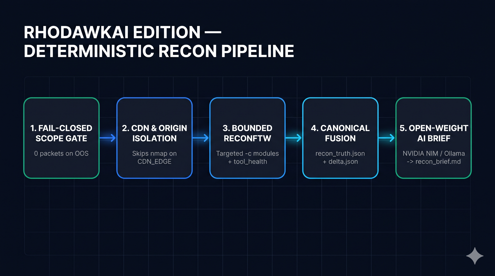

<div align="center">


**AI-powered bug bounty hunting — recon to report, in your terminal.**
Fail-closed, CDN-aware, deterministic. Zero closed-model lock-in.

[](https://github.com/Rhodawk-AI/rhodawk-bounty-hunter/actions/workflows/ci.yml)
[](https://pypi.org/project/rhodawk-bounty-hunter/)
[](https://www.npmjs.com/package/@rhodawkai/bounty-hunter)
[](pyproject.toml)
[](LICENSE)

<p align="center">
  <a href="./PLAYBOOK.md">🚀 5-Min Operator Playbook</a> •
  <a href="./BENCHMARKS.md">📊 Live Benchmarks</a> •
  <a href="./FAQ.md">FAQ</a> •
  <a href="./NOTICE">Attribution</a> •
  <a href="./LICENSE">MIT License</a>
</p>

**[Demo](#-live-demo) · [Security Architecture](#-security-architecture) · [Install](#-install) · [Quick Start](#-quick-start-5-commands) · [What Changed from Upstream](#-what-changed-from-upstream-agentic-bug-hunter) · [CLI & MCP](#-cli-reference) · [AI Providers](#-open-weight--multi-provider-ai) · [reconFTW Delegation](#-deterministic-reconftw-delegation) · [Honest Limitations](#-honest-limitations--responsible-use) · [Credits](#️-credits--attribution)**

</div>

---

## 🎬 Live Demo

<p align="center">
  
</p>

<p align="center">
  <em>Recorded live on an 8-vCPU Ubuntu VPS: <code>rhodawk doctor</code> (<code>0 FAIL</code>, <code>&lt;5s</code>) → fail-closed OOS scope block (<code>0</code> packets) → live CDN-aware recon on <code>rhodawkai.com</code> → canonical <code>recon_truth.json</code> + AI <code>recon_brief.md</code>.</em>
</p>

## 🛡️ What Is This?

`rhodawk` is a terminal-first bug bounty agent for bug-bounty programs. It is
an **authorized-testing workflow engine**: it fuses a deterministic recon
pipeline (subdomain enumeration, live-host probing, URL collection, port and
parameter discovery) with an LLM brain that runs fully local (Ollama) or
against any OpenAI-compatible provider. Every stage is gated:

- **Scope first, always.** Active stages refuse to start without a hash-verified
  scope manifest; out-of-scope targets abort with **zero packets sent to them**.
- **Deterministic delegation.** Capability gaps are filled by reconFTW through a
  fixed, code-level routing table — never an LLM judgment call.
- **Clean-room verification.** Findings are promoted only through a 7-question
  validation gate with provenance-tracked evidence.

**Platform coverage (honest):** scope compilation is **HackerOne-only today**
(paginated REST + keyless GraphQL fallback). Bugcrowd / Intigriti / YesWeHack
credentials can be stored in the vault for manual sessions — no scope compiler
or API integration exists for them yet. Any program's scope can be pinned
without a platform using `--scope-domain '*.target.com'` patterns.

## 🔐 Security Architecture — code-enforced vs. LLM-assisted

Not every boundary below is enforced the same way. Read the split before your
first hunt.

**Code-enforced (deterministic — no model judgment involved):**

| Boundary | Mechanism |
|---|---|
| **Scope authority** | Paginated, SHA-256-verified `CompiledScopeManifest` (`recon/<handle>/scope/compiled_scope.json`) — tampered manifest = hard block |
| **Scope checker** | Fail-closed `ScopeChecker` host/IP/path matcher — `exit 3` in the recon engines, `SCOPE_REQUIRED` in MCP |
| **Pre-flight gate** | `recon_engine.sh` refuses manifest-less / out-of-scope runs **before any packet**; every block is audited to `hunt-memory/audit.jsonl` |
| **Post-enumeration filter** | Discovered hosts/URLs are re-checked before probing; out-of-scope entries quarantined to `scope/dropped_oos.txt`; checker crash aborts the run |
| **Per-scanner gate** | `_scope_gate.sh` sourced by 10 scanners (vuln, secrets, 403, params, CVE, OSINT, takeover, cloud, GraphQL, wordlists) |
| **Tool-call hooks** | Deterministic `PreToolUse` scope guard (`SCOPE_HOOK_BLOCK`) wired through `hooks/hooks.json` — unparseable input or missing/tampered manifest blocks |
| **SSRF / hop-0** | `initial_host_blocked` gates verifier fetches, PoC capture and the fuzzer before any socket or browser launch (metadata/private/loopback always blocked) |
| **CDN quarantine** | Pre-probe dnsx 3rd-party SaaS CNAME quarantine drops `*.zendesk.com`-style edge hosts before any packet leaves |
| **Credential vault** | `chmod 600 ~/.rhodawk/.env` (directory `0700`), atomic writes, one-time migration from the pre-2.0 data home |
| **Report gate** | Report-ready requires verifier-confirmed status **and** linked evidence **and** enforced scope |
| **Data home** | All runtime artifacts live under `$RHODAWK_HOME` (default `~/.rhodawk`) — never the package install tree |

**LLM-assisted (prompt-level — NOT hard boundaries):**

| Layer | Reality |
|---|---|
| **7-Question Gate verdict** | Questions live in prompt text; code parses and persists the `VERDICT:` line — SUBMIT/CHAIN/DROP is the model's judgment, with the deterministic gates above as backstop |
| **Data-plane isolation** | `<untrusted_target_data>` wrapping is declared in the agent prompts (`rhodawk/prompts/kernel.md`); it constrains the model's interpretation, not the kernel |
| **Session scope reminders** | SessionStart/Stop hooks are echo-only reinforcement |
| **Arbitrary Bash** | The `PreToolUse` hook classifies unknown commands as read-only — a bare `curl` to an out-of-scope host is **not** blocked by the hook |



## 🚀 Install

**PyPI (recommended):**

```bash
pipx install rhodawk-bounty-hunter
# or
uv tool install rhodawk-bounty-hunter
```

**npm (thin CLI wrapper around the PyPI package — it does NOT bundle the
tool):** the wrapper chains to a pipx/pip-installed `rhodawk` binary (or falls
back to `pipx run`); if the PyPI package is absent it prints an install hint.

```bash
pipx install rhodawk-bounty-hunter     # install the actual package first
npm install -g @rhodawkai/bounty-hunter
npx @rhodawkai/bounty-hunter doctor
```

**From source:**

```bash
git clone https://github.com/Rhodawk-AI/rhodawk-bounty-hunter.git
cd rhodawk-bounty-hunter
./install.sh --agent standalone
```

**External security binaries are installed separately** via `./install_tools.sh`
(subfinder, httpx, nuclei, katana, ffuf, nmap, …) — the Python package alone
only runs the gated pipeline shells that call them. **There is no official
Docker image yet**: for isolation, bring your own container/VM and mount a
volume at `RHODAWK_HOME` — everything the tool writes (recon, findings,
reports, hunt-memory, vault, capabilities) lives under that one directory.

## ⚡ Quick Start (5 Commands)

```bash
# 0. Configure an LLM brain first — hunt/validate/report need a provider
#    (Ollama = free & local, or any hosted key via `rhodawk setup`)
rhodawk setup

# 1. Install the external arsenal + the managed Chromium (katana SPA crawling)
./install_tools.sh

# 2. Verify everything in <5 seconds (exit 1 on any FAIL)
rhodawk doctor

# 3. Compile the authoritative scope manifest for a program
#    (or pin scope manually: rhodawk recon <target> --scope-domain '*.target.com')
rhodawk scope-compile <program-handle>

# 4. Run live, CDN-aware recon (fail-closed: out-of-scope target => exit 3, 0 packets)
rhodawk recon <target>

# 5. Hunt, validate, report (validate is interactive; report requires validation.json)
rhodawk hunt <target> && rhodawk validate && rhodawk report
```

## 💻 CLI Reference

| Command | What it does |
|---|---|
| `rhodawk setup` | Persist provider/model to `~/.rhodawk/config.json` |
| `rhodawk doctor` | Fast environment diagnostic — PASS/WARN/FAIL + 1-line fixes |
| `rhodawk scope-compile <handle>` | Compile the authoritative SHA-256 scope manifest |
| `rhodawk recon <target>` | Scoped recon + AI surface analysis |
| `rhodawk hunt <target>` | Full hunt pipeline (recon → hypothesis → clean-room verify) |
| `rhodawk validate` | 7-Question Gate on a finding |
| `rhodawk triage` | Fast triage (alias of validate) |
| `rhodawk report` | Write a submission-ready bug report |
| `rhodawk mcp` | MCP server / doctor / tool catalog |
| `rhodawk providers` · `models` · `status` · `chat` | Provider and session tooling |

**Agent slash commands** (Claude Code / OpenCode — 43 shipped; the core six):
`/scope` · `/scope-aggregate` · `/recon` · `/hunt` · `/validate` · `/report`

## 🤝 MCP — Drive RhodawkAI from Any Agent

The bundled `rhodawk-mcp` server exposes the whole engine as typed MCP tools
(`rhodawk_recon`, `rhodawk_hunt`, `rhodawk_compile_scope`, `rhodawk_validate`,
…) with per-tool security metadata, approval levels, and server-side policy
inputs. Every active tool requires a scope source and `approve=true`; read-only
tools never touch the target. Wire it in one line:

```bash
claude mcp add rhodawk -- rhodawk mcp serve
```

## 🧠 Open-Weight & Multi-Provider AI

- **Ollama** — 100% free, fully offline
- **NVIDIA NIM** — open weights, hosted
- **Groq · DeepSeek · Cerebras · Mistral · Gemini · Claude · OpenAI · Grok · OpenRouter · OrcaRouter · LiteLLM · Requesty** — auto-detected, free-first

```bash
rhodawk setup        # pick a provider, paste a key, choose a model
```

## 🔧 Deterministic reconFTW Delegation

Wherever the native pipeline hits a capability gap, a typed registry
(`rhodawk/tools/capability_registry.py`) routes the work to reconFTW through a
fixed six-step flow: typed capability ID → native-parity guard → 7-day-TTL dedup
→ availability check → fail-closed scope gate → single-function reconFTW call in
an isolated workdir. The 7 verified gap map covers ASN/CIDR enumeration, DNS
permutation, CDN/origin isolation, JS source-map secrets, virtual-host
discovery, TLS IP pivots, and favicon fingerprinting. Vulnerability scanning is
never delegated — the verifier spine stays local.

## 🔍 What Changed from Upstream `Agentic-Bug-Hunter`

RhodawkAI Bounty Hunter is a standalone edition of the MIT-licensed
[Agentic-Bug-Hunter](https://github.com/awarexone/Agentic-Bug-Hunter) framework
(upstream commit `82f4512`). Attribution is preserved in [NOTICE](NOTICE). The
412 shared files split into 199 byte-identical and 213 modified; the verified
headline deltas:

| Area | Upstream | RhodawkAI Edition |
|---|---|---|
| **Scope intake** | `scope_aggregator.sh` — substring handle matching, `*.` wildcards stripped, first-50 truncation | `rhodawk scope-compile`: paginated H1 REST (no 50-item cap), exact-handle match, SHA-256-sealed `CompiledScopeManifest`; tamper ⇒ hard block |
| **Scope enforcement** | Engine CLI ran recon bare; only httpx redirect-following disabled in shell | Fail-closed pre-flight gate (`exit 3`, 0 packets), post-enumeration quarantine filter, `_scope_gate.sh` in 10 scanners, `PreToolUse` hook (`SCOPE_HOOK_BLOCK`) |
| **MCP scope authority** | Caller could self-authorize (`scope_domains or [target]`) | Self-authorization removed — verified manifest or explicit domains only; caller scope audited |
| **SSRF / hop-0** | Only redirect hops checked; verifier `fetch()` and PoC `capture()` could hit metadata/private hosts; fuzzer ungated | One canonical hop-0 gate before any socket/browser launch in verifiers, PoC bundler and fuzzer; scope mandatory, fail-closed |
| **TLS** | `CERT_NONE` fallback in `_spray_http_form.py` | Always `ssl.create_default_context()` |
| **Secrets** | H1 tokens passed as CLI argv; no managed vault | `~/.rhodawk/.env` vault (0600/0700, atomic writes); tokens via env / mktemp header files, never argv |
| **Subprocess** | Two `shell=True` scan invocations; bare `kill()` on timeout | argv lists only (except hardcoded version probes); whole process-group SIGKILL with reaping wait |
| **Validation** | Evidence optional (`or not session_dir` hole) | Evidence **mandatory**; report-ready additionally requires `scope_enforced` |
| **Recon output** | Flat `.txt` files, install-tree/CWD rooted | Canonical `recon_truth.json` + run-over-run `delta.json`; artifacts always under `$RHODAWK_HOME` |
| **Capability gaps** | — | Deterministic reconFTW delegation: 7 typed capability IDs, pinned checkout, 7-day dedup, fail-closed scope pre/post call |
| **LLM providers** | fluxion + 14 providers, env-only | fluxion removed; **NVIDIA NIM added**; provider/keys persist in `config.json` |
| **Removed** | — | `netflix-privacy-analysis/` doc project, 8 `docs/phase*.md`, sponsor assets |

## 📊 Benchmarks

Timed, per-domain, honestly annotated — RhodawkAI Bounty Hunter vs the upstream
baseline vs standalone reconFTW: see [BENCHMARKS.md](BENCHMARKS.md) and
[.github/benchmarks.md](.github/benchmarks.md).

## 📁 Project Structure

```
rhodawk/            the Python package (engine, brain, MCP, tools, prompts)
commands/           43 agent slash commands
skills/             25 methodology + toolkit skills
hooks/hooks.json    PreToolUse deterministic scope hooks
demo/               local vulnerable demo lab (demo-lab.rhodawkai.test)
docs/               deep-dive documentation
site/               project landing page
```

## ⚠️ Honest Limitations & Responsible Use

Read this before your first hunt — several boundaries are prompt-level, and a
few caveats are structural.

**Limitations:**

- **Authorized targets only.** The scope gate is fail-closed when a manifest or
  `--scope-domain` patterns are provided — but a manifest-less run leaves the
  shell gate inactive by design, and IP/CIDR targets self-scope. **You are the
  authorization layer of last resort.**
- **Scope manifests are tamper-evident, not signed.** The SHA-256 detects
  modification, not authorship: whoever can write `compiled_scope.json` (a
  0700/0600 home) can authorize that scope. Protect your `RHODAWK_HOME`.
- **The `PreToolUse` hook does not cover arbitrary Bash.** Unknown commands
  (e.g. a raw `curl`) pass the hook; only the bundled scripts/CLI paths are gated.
- **HTTP guard caveats (both editions):** no scheme allowlist (`file://`), no
  port allowlist, and a DNS-rebinding TOCTOU window in the shared HTTP guard;
  the fuzzer's target check is pre-flight, not a connection pin.
- **Operator-supplied spray targets are ungated:** `_spray_oauth.py` /
  `_spray_http_form.py` send to whatever URL you pass — point them only at
  programs whose policy explicitly allows credential-spray testing.
- **7-Question Gate verdicts are model-judged** (SUBMIT/CHAIN/DROP); the
  deterministic kill/chain/identity/evidence gates in `validate_core.py` are
  the backstop. Never submit without reading the evidence yourself.
- **Secrets reach scanner child processes** (vault-exported env vars); only the
  exploit-exec path runs with a stripped env allowlist. Assume any subprocess
  can see vault-exported variables.
- **Platform coverage:** scope compilation is HackerOne-only today;
  Bugcrowd/Intigriti/YesWeHack are vault-only. No official Docker image.
- **Benchmarks are environment-specific** (5 authorized vulnweb/scanme domains,
  one VPS) — treat [BENCHMARKS.md](BENCHMARKS.md) as reproducible methodology,
  not a guarantee.

**Responsible use:**

1. Hunt **only** programs whose policy authorizes you — `scope-compile` exists
   so you never have to trust a pasted target list.
2. Respect `max_rps` and `mandatory_headers` from the program policy — the
   manifest enforces them as pipeline defaults.
3. Validate before reporting: a finding without linked evidence is never
   report-ready; use `rhodawk validate` and attach the PoC bundle.
4. Keep upstream attribution ([NOTICE](NOTICE)) intact — this edition is built
   on an MIT-licensed framework.

## ❤️ Credits & Attribution

RhodawkAI Bounty Hunter is a standalone edition built on an MIT-licensed
upstream framework. Upstream attribution is preserved in [NOTICE](NOTICE) —
please keep it intact in redistributions.

## License

MIT — see [LICENSE](LICENSE). Hunt only what you are authorized to hunt.
