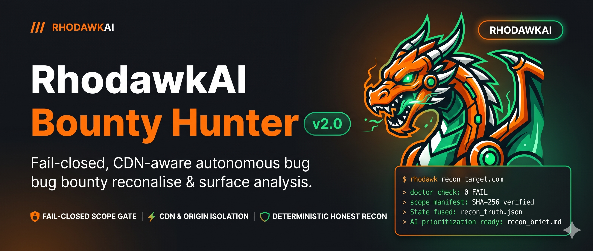
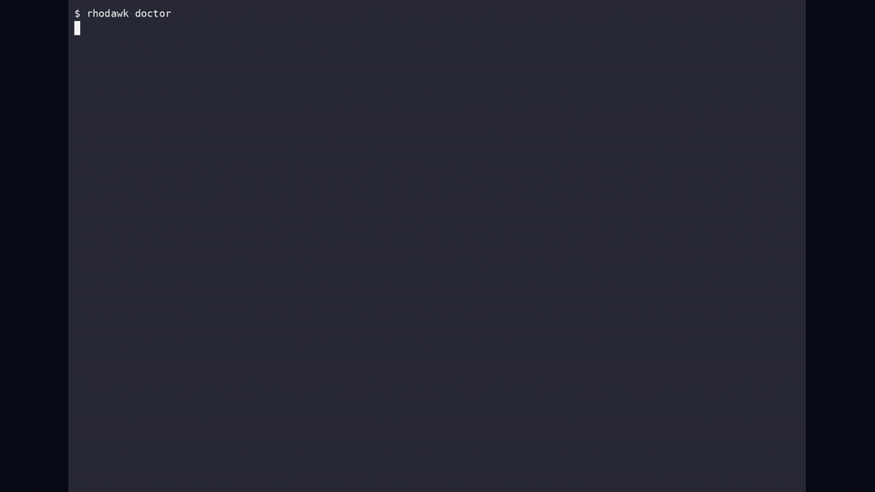

<div align="center">



**AI-powered bug bounty hunting — recon to report, in your terminal.**
Fail-closed, CDN-aware, deterministic. Zero closed-model lock-in.

[](https://github.com/Rhodawk-AI/rhodawk-bounty-hunter/actions/workflows/ci.yml)
[](https://pypi.org/project/rhodawk-bounty-hunter/)
[](https://www.npmjs.com/package/@rhodawkai/bounty-hunter)
[](pyproject.toml)
[](LICENSE)

<p align="center">
  <a href="./PLAYBOOK.md">🚀 5-Min Operator Playbook</a> •
  <a href="./BENCHMARKS.md">📊 Live Benchmarks</a> •
  <a href="./FAQ.md">FAQ</a> •
  <a href="./NOTICE">Attribution</a> •
  <a href="./LICENSE">MIT License</a>
</p>

**[Demo](#-live-demo) · [Security Architecture](#-security-architecture) · [Install](#-install) · [Quick Start](#-quick-start-5-commands) · [CLI & MCP](#-cli-reference) · [AI Providers](#-open-weight--multi-provider-ai) · [reconFTW Delegation](#-deterministic-reconftw-delegation) · [Credits](#️-credits--attribution)**

</div>

---

## 🎬 Live Demo

<p align="center">
  
</p>

<p align="center">
  <em>Recorded live on an 8-vCPU Ubuntu VPS: <code>rhodawk doctor</code> (<code>0 FAIL</code>, <code>&lt;5s</code>) → fail-closed OOS scope block (<code>0</code> packets) → live CDN-aware recon on <code>rhodawkai.com</code> → canonical <code>recon_truth.json</code> + AI <code>recon_brief.md</code>.</em>
</p>

## 🛡️ What Is This?

`rhodawk` is a terminal-first bug bounty agent for **HackerOne, Bugcrowd,
Intigriti, and Immunefi** programs. It fuses a deterministic recon pipeline
(subdomain enumeration, live-host probing, URL collection, port and parameter
discovery) with an LLM brain that runs fully local (Ollama) or against any
OpenAI-compatible provider. Every stage is gated:

- **Scope first, always.** Active stages refuse to start without a hash-verified
  scope manifest; out-of-scope targets abort with **zero packets sent to them**.
- **Deterministic delegation.** Capability gaps are filled by reconFTW through a
  fixed, code-level routing table — never an LLM judgment call.
- **Clean-room verification.** Findings are promoted only through a 7-question
  validation gate with provenance-tracked evidence.

## 🔐 Security Architecture

| Layer | Mechanism |
|---|---|
| **Credential vault** | `chmod 600 ~/.rhodawk/.env` multi-platform vault (directory `0700`) with one-time automatic migration from the pre-2.0 data home |
| **Scope authority** | Paginated, SHA-256-verified `CompiledScopeManifest` (`recon/<handle>/scope/compiled_scope.json`) — tampered manifest = hard block |
| **CDN quarantine** | Pre-probe dnsx 3rd-party SaaS CNAME quarantine drops `*.zendesk.com`-style edge hosts before any packet leaves |
| **Scope checker** | Fail-closed `ScopeChecker` — `exit 3` in the recon engines, `SCOPE_REQUIRED` in MCP |
| **Tool-call hooks** | Deterministic `PreToolUse` scope hooks (`SCOPE_HOOK_BLOCK`) wired through `hooks/hooks.json` |
| **Data-plane isolation** | All target HTTP/content is wrapped in `<untrusted_target_data>` — never treated as instructions |


## 🚀 Install

**PyPI (recommended):**

```bash
pipx install rhodawk-bounty-hunter
# or
uv tool install rhodawk-bounty-hunter
```

**npm (CLI wrapper around the PyPI package):**

```bash
npm install -g @rhodawkai/bounty-hunter
# verify the toolchain directly:
npx @rhodawkai/bounty-hunter doctor
```

**From source:**

```bash
git clone https://github.com/Rhodawk-AI/rhodawk-bounty-hunter.git
cd rhodawk-bounty-hunter
./install.sh --agent standalone
```

## ⚡ Quick Start (5 Commands)

```bash
# 1. Install the external arsenal + the managed Chromium (katana SPA crawling)
./install_tools.sh

# 2. Verify everything in <5 seconds
rhodawk doctor

# 3. Compile the authoritative scope manifest for a program
rhodawk scope-compile <program-handle>

# 4. Run live, CDN-aware recon
rhodawk recon <target>

# 5. Hunt, validate, report
rhodawk hunt <target> && rhodawk validate && rhodawk report
```

## 💻 CLI Reference

| Command | What it does |
|---|---|
| `rhodawk setup` | Persist provider/model to `~/.rhodawk/config.json` |
| `rhodawk doctor` | Fast environment diagnostic — PASS/WARN/FAIL + 1-line fixes |
| `rhodawk scope-compile <handle>` | Compile the authoritative SHA-256 scope manifest |
| `rhodawk recon <target>` | Scoped recon + AI surface analysis |
| `rhodawk hunt <target>` | Full hunt pipeline (recon → hypothesis → clean-room verify) |
| `rhodawk validate` | 7-Question Gate on a finding |
| `rhodawk triage` | Fast triage (alias of validate) |
| `rhodawk report` | Write a submission-ready bug report |
| `rhodawk mcp` | MCP server / doctor / tool catalog |
| `rhodawk providers` · `models` · `status` · `chat` | Provider and session tooling |

**Agent slash commands** (Claude Code / OpenCode — 43 shipped; the core six):
`/scope` · `/scope-aggregate` · `/recon` · `/hunt` · `/validate` · `/report`

## 🤝 MCP — Drive RhodawkAI from Any Agent

The bundled `rhodawk-mcp` server exposes the whole engine as typed MCP tools
(`rhodawk_recon`, `rhodawk_hunt`, `rhodawk_compile_scope`, `rhodawk_validate`,
…) with per-tool security metadata, approval levels, and server-side policy
inputs. Every active tool requires a scope source and `approve=true`; read-only
tools never touch the target. Wire it in one line:

```bash
claude mcp add rhodawk -- rhodawk mcp serve
```

## 🧠 Open-Weight & Multi-Provider AI

- **Ollama** — 100% free, fully offline
- **NVIDIA NIM** — open weights, hosted
- **Groq · DeepSeek · Cerebras · Mistral · Gemini · Claude · OpenAI · Grok · OpenRouter · OrcaRouter · LiteLLM · Requesty** — auto-detected, free-first

```bash
rhodawk setup        # pick a provider, paste a key, choose a model
```

## 🔧 Deterministic reconFTW Delegation

Wherever the native pipeline hits a capability gap, a typed registry
(`rhodawk/tools/capability_registry.py`) routes the work to reconFTW through a
fixed six-step flow: typed capability ID → native-parity guard → 7-day-TTL dedup
→ availability check → fail-closed scope gate → single-function reconFTW call in
an isolated workdir. The 7 verified gap map covers ASN/CIDR enumeration, DNS
permutation, CDN/origin isolation, JS source-map secrets, virtual-host
discovery, TLS IP pivots, and favicon fingerprinting. Vulnerability scanning is
never delegated — the verifier spine stays local.

## 📊 Benchmarks

Timed, per-domain, honestly annotated — RhodawkAI Bounty Hunter vs the upstream
baseline vs standalone reconFTW: see [BENCHMARKS.md](BENCHMARKS.md) and
[.github/benchmarks.md](.github/benchmarks.md).

## 📁 Project Structure

```
rhodawk/            the Python package (engine, brain, MCP, tools, prompts)
commands/           43 agent slash commands
skills/             25 methodology + toolkit skills
hooks/hooks.json    PreToolUse deterministic scope hooks
demo/               local vulnerable demo lab (demo-lab.rhodawkai.test)
docs/               deep-dive documentation
site/               project landing page
```

## ❤️ Credits & Attribution

RhodawkAI Bounty Hunter is a standalone edition built on an MIT-licensed
upstream framework. Upstream attribution is preserved in [NOTICE](NOTICE) —
please keep it intact in redistributions.

## License

MIT — see [LICENSE](LICENSE). Hunt only what you are authorized to hunt.
